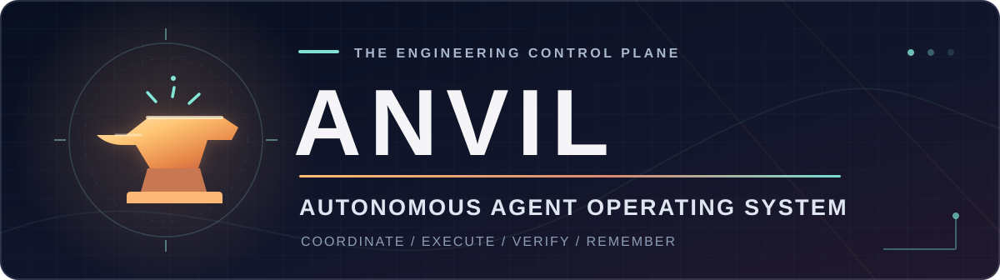
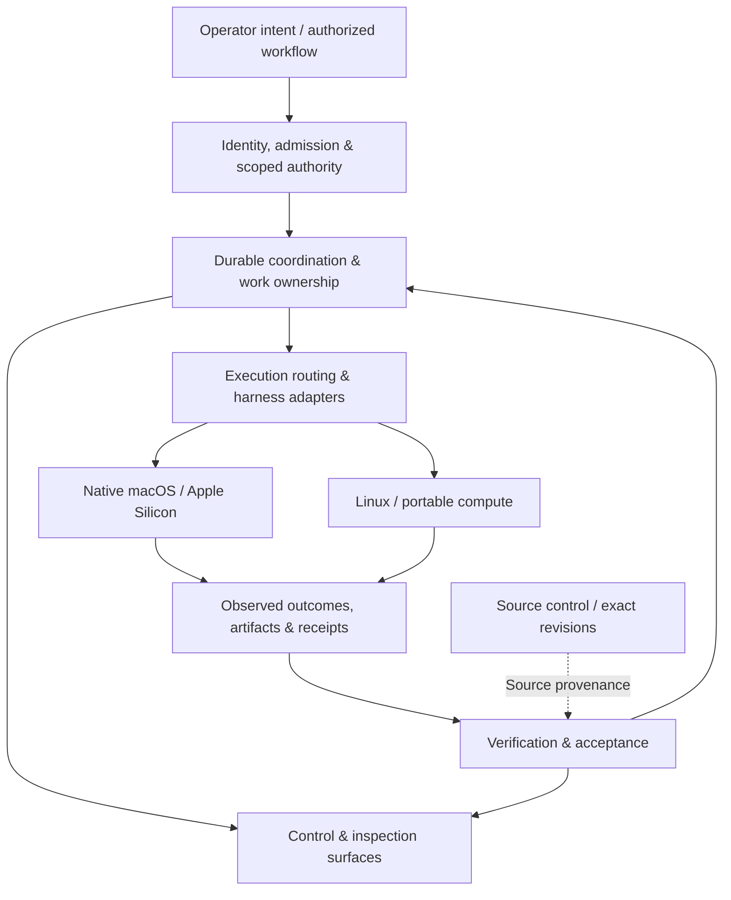

  

  <h3>Agents that remember. Work that survives. Results you can verify.</h3>

  **A**gent **N**etwork for **V**erification, **I**ntegration, and **L**ineage

  A native-first coordination fabric for accountable AI-agent execution across heterogeneous runtimes and machines.

  

    
    
    
    
    
  

  [Architecture](docs/ARCHITECTURE.md) · [Verification model](docs/VERIFICATION.md) · [Research](#research-directions) · [MacBrains Labs](https://macbrainslabs.org/)

---

> [!IMPORTANT]
> **This is ANVIL's public technical overview, not its source repository.** The implementation, deployment configuration, operational state, and internal project records remain private. Nothing here implies a public release, hosted service, or available software download.

## The problem ANVIL is built to solve

Contemporary AI agents can generate code, operate tools, and delegate tasks. Their harder problem is **maintaining accountable execution over time**. Once work crosses session boundaries, machines, models, or harnesses, familiar failure modes appear:

- **Identity drift:** a new invocation is mistaken for the actor or session that performed earlier work.
- **Ambiguous ownership:** multiple workers believe they may modify the same resource.
- **Lost continuity:** a context reset or process restart severs the link between intent, action, and result.
- **Unfounded completion:** a green test or merged change is presented as proof of installed, functioning software.
- **Fragmented observability:** source control, operating systems, agent clients, and task records disagree about what actually happened.

ANVIL approaches these as **distributed-systems and verification problems**, rather than prompt-engineering problems.

## Design thesis

**One accountable work fabric; multiple independent execution environments.**

ANVIL coordinates work without pretending that agents share a memory, filesystem, privilege level, or execution host. The system's design emphasizes explicit identity, scoped authority, durable state, provenance-aware handoffs, and acceptance evidence from the authority that owns each claim.

| Principle | Technical objective |
| :-- | :-- |
| **A · Agent** | Identify actors and native sessions without erasing provenance or confusing an agent with its execution harness. |
| **N · Network** | Coordinate execution across distinct runtime, machine, and trust boundaries. |
| **V · Verification** | Tie correctness claims to exact inputs, source revisions, artifacts, tests, and host-observed outcomes. |
| **I · Integration** | Treat an end-to-end working workflow as the deliverable, not a collection of individually successful components. |
| **L · Lineage** | Preserve the relationships among tasks, attempts, sessions, ownership, decisions, and outcomes. |

## Logical architecture

The following diagram describes the **public conceptual architecture**. It intentionally omits private topology, schemas, APIs, service names, and deployment details.

The architectural separation is deliberate:

1. **Control plane:** decides what work is authorized, owned, or eligible to continue.
2. **Execution plane:** performs bounded work on the appropriate host with the appropriate toolchain.
3. **Evidence plane:** records what ran and what the relevant system actually observed.
4. **Inspection plane:** makes identity, state, uncertainty, and outcomes intelligible to an operator.

These are *logical responsibilities*, not claims about a particular number of services or deployment instances. See the [architecture notes](docs/ARCHITECTURE.md) for the conceptual contracts and failure model.

## Engineering invariants

ANVIL's approach is shaped by a small set of non-negotiable engineering rules:

- **Authority is explicit.** A reachable tool or machine is not, by itself, permission to change it.
- **Identity is preserved.** Native identifiers and provenance should not be rewritten into lossy substitutes.
- **Ownership is bounded.** Concurrent or recovered workers must not silently assume another worker's active claim.
- **Source truth is exact.** A test against one commit does not establish properties of another commit, branch, or installed build.
- **Observations have epistemic state.** Missing, stale, conflicted, and verified information must not collapse into the same value.
- **Acceptance is operational.** A source change, passing test, merged PR, deployed service, and functioning user-facing workflow are distinct milestones.
- **Recovery is designed in.** Interruption is a normal distributed-systems event, not a reason to lose task lineage or repeat unverified side effects.

These are design and acceptance criteria. They must not be read as a claim that every implementation path has achieved production acceptance.

## Research directions

ANVIL sits at the intersection of several engineering disciplines:

| Area | Research focus |
| :-- | :-- |
| **Native agent runtimes** | Swift-first system integration, typed interfaces, bounded tool execution, and lifecycle management. |
| **Distributed coordination** | Task ownership, session lineage, cross-host execution, recovery, and control-plane authority. |
| **Verification infrastructure** | Exact-source tests, provenance, independent checks, evidence quality, and deployment acceptance. |
| **Heterogeneous compute** | Routing between Apple Silicon-specific operations and portable Linux execution without hiding host differences. |
| **Human-visible autonomy** | Inspectable, interruptible work with clear authority boundaries and traceable outcomes. |

The broader Apple Neural Engine and Core ML research has its own [public methods](https://macbrainslabs.org/methods/) and [research index](https://macbrainslabs.org/research/). ANVIL's remit is coordinating and verifying work; published accelerator measurements are not ANVIL performance benchmarks.

## Documentation

| Document | Contents |
| :-- | :-- |
| [Public architecture](docs/ARCHITECTURE.md) | Logical planes, identity, authority, execution boundaries, and recovery behavior. |
| [Verification model](docs/VERIFICATION.md) | Evidence taxonomy, acceptance levels, and the distinction between source and production claims. |
| [Security and disclosure](SECURITY.md) | Public-documentation scope and security contact. |

## Project status and availability

**Private implementation · active research and development.** This repository contains only deliberately published project documentation and visual assets. It does not contain ANVIL's implementation, internal specifications, operational credentials, infrastructure configuration, runtime endpoints, or private issue/receipt history.

Technical material here documents project objectives and architecture at a *conceptual* level. A described invariant is not a certification that every subsystem has passed its runtime acceptance gates. No public releases, installation instructions, commercial support terms, or open-source license for the private code are implied.

**Research home:** [MacBrains Labs](https://macbrainslabs.org/) · **Technical correspondence:** [research@macbrainslabs.org](mailto:research@macbrainslabs.org)

Independent research. Not affiliated with Apple or other platform/model vendors mentioned in related research.
