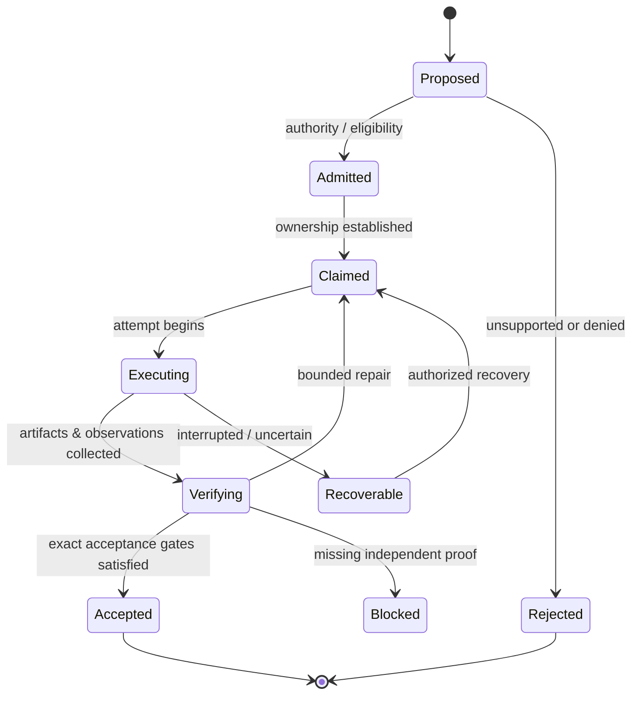

# ANVIL · Public architecture notes

> **Scope:** conceptual systems architecture. This document is deliberately not an API specification, database schema, deployment guide, network diagram, security configuration, or claim that every design objective is installed and verified.

[← Project overview](../README.md) · [Verification model](VERIFICATION.md)

## 1. System boundary

ANVIL — **Agent Network for Verification, Integration, and Lineage** — investigates how to coordinate AI agents as accountable, long-running engineering actors rather than isolated chat sessions.

The unit of value is not a response. It is a **traceable change in the world**: a source revision, test result, artifact, deployment observation, or verified operational outcome. Each must retain enough context to explain *who acted, under which authority, on which inputs, with what evidence, and what remains uncertain*.

The design separates four responsibilities:

| Logical plane | Primary responsibility | What it does not establish by itself |
| :-- | :-- | :-- |
| **Control** | Admission, authority, scheduling eligibility, claims, and recovery decisions. | That any execution actually occurred. |
| **Execution** | Run bounded work using a harness/toolchain on a suitable machine. | That the outcome is correct or accepted. |
| **Evidence** | Preserve artifacts, measurements, observed state, and provenance. | That the evidence covers a different input, revision, or host. |
| **Inspection** | Expose work state, ownership, lineage, and the basis for a decision. | Authority to mutate resources merely because they are visible. |

These planes are conceptual separation-of-concerns boundaries; they do not prescribe a particular microservice topology.

## 2. Identity and authority

A multi-agent system cannot substitute a model name or a conversation title for a durable actor identity. Its conceptual identity model distinguishes:

- **Actor:** the responsible principal or agent.
- **Task:** the intended unit of work and its acceptance boundary.
- **Attempt:** an execution episode; retries are not the original event.
- **Session:** a native identity assigned by the hosting agent harness.
- **Lease / claim:** bounded ownership of an operation or resource.
- **Evidence:** observations tied to the specific attempt, source, and authority.

The key invariant is **non-equivalence**: two native sessions that look similar are not the same session; two attempts on one task are not interchangeable; and a valid command channel is not unrestricted permission.

Correctness requires respecting the authority domain for each claim. Source control can attest to a commit; an operating system can attest to a running process; a harness can report its native session; a task ledger can report ownership. These are related facts, not substitutes.

## 3. Work lifecycle

A simplified, *illustrative* lifecycle is:

No arrow implies that a retry may ignore previous effects. When execution is interrupted, the system must first distinguish **unknown outcome** from **known failure**, reconcile prior attempts, and prevent an obsolete worker from silently taking ownership.

The diagram explains the intended semantics; it is not the project's private state-machine schema.

## 4. Source, runtime, and evidence are separate truths

ANVIL treats several kinds of source truth as independent:

| Source of truth | Suitable claims |
| :-- | :-- |
| **Git and review history** | Exact commits, diffs, review decisions, branch state. |
| **Durable work records** | Claims, attempts, authority decisions, task history. |
| **Execution hosts** | Process status, loaded packages, runtime versions, hardware-specific observations. |
| **Artifacts and receipts** | Test inputs/outputs, logs, checksums, provenance, verification results. |
| **Operator-facing surface** | What a person can actually see and operate after deployment. |

A passing portable test is evidence about its tested configuration. It does not imply installation on every host. An installed service is not automatically proof that an end-user workflow functions. For acceptance criteria, see [the verification model](VERIFICATION.md).

## 5. Heterogeneous execution

The architecture recognizes a practical asymmetry:

- **macOS / Apple Silicon:** native toolchains, Apple platform APIs, Core ML, and Neural Engine-related work.
- **Linux:** portable builds, data preparation, batch processing, and non-Apple toolchains.
- **Remote model providers and agent harnesses:** distinct session semantics, capabilities, cost structures, and availability.

A sound routing decision considers the **required capability, evidence obligations, authority boundary, and source locality**. It must not assume shared storage, equivalent GPUs/accelerators, interchangeable tool behavior, or uniform privilege.

The public diagram does not disclose actual host inventory, addresses, queues, storage layouts, or trust configuration.

## 6. Failure model

| Failure class | Intended engineering response |
| :-- | :-- |
| Repeated or out-of-order event | Preserve event identity and reconcile against already-observed effects. |
| Interrupted agent session | Reacquire native identity and work ownership; distinguish resume from replay. |
| Competing workers | Fence stale ownership; prefer explicit handoff over ambiguous continuation. |
| Unreachable execution host | Mark the relevant observation unknown or stale, not zero or healthy. |
| Source revision changes | Rebind tests and receipts to the new exact revision before acceptance. |
| Conflicting reports | Preserve the conflict and obtain higher-authority evidence. |
| Incomplete deployment | Keep source completion and production acceptance distinct. |

This table is a design rationale, not a published statement that every failure class has been exhaustively tested.

## 7. Research constraints

This repository omits the material that would be necessary to reproduce ANVIL as a running system: code, configuration, internal contracts, security controls, real task state, endpoints, and private operational records. The omissions are intentional.

The architecture is therefore **inspectable as a research direction, not independently buildable from this repository**. For the associated public research program and measurement discipline, see [MacBrains Labs](https://macbrainslabs.org/) and the [methods page](https://macbrainslabs.org/methods/).
