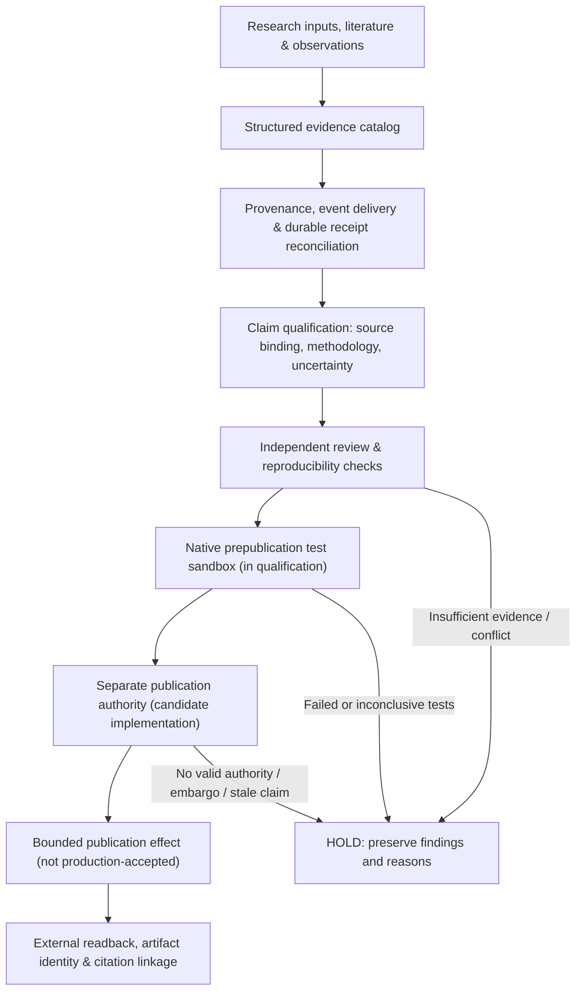

# ANVIL · Evidence pipeline and research publication qualification

> **Scope and maturity:** This is a public, implementation-informed description of the ANVIL research evidence workflow. Research cataloging, provenance-aware event reconciliation, and publication-eligibility visibility have been observed in working system records. A separately authorized publication issuer and purpose-built prepublication sandbox qualification are **under development**. This is not an assertion that unattended scientific publication is installed, enabled, or production-accepted.

[← Project overview](../README.md) · [Architecture](ARCHITECTURE.md) · [Verification standard](VERIFICATION.md)

## Why evidence is a first-class subsystem

Agent orchestration can answer *which worker did something*. Research and engineering accountability additionally require answers to *what supports the result, whether the result was reproduced, which revision was tested, whose independent review is represented, and whether an external publication was actually authorized and observed*.

ANVIL's evidence pipeline is designed to preserve that distinction throughout a long-running, multi-agent workflow. It treats claims, artifacts, measurements, reviews, publication policy, and external effects as related but **non-interchangeable records**.

**The design thesis:** a research conclusion cannot become an approved public artifact merely because an AI model produced a compelling explanation, a test process exited successfully, or a publication request was queued.

## Logical evidence-to-publication path

This is a **logical workflow**, not a claim that every pictured stage is connected in a live production pipeline. In particular, the prepublication test sandbox, the separate publication issuer, and public-effect acceptance must not be conflated with the already observed research catalog and event-delivery components.

## Engineering properties

| Property | Why it matters |
| :-- | :-- |
| **Evidence provenance** | Relate an observation to its input, source, actor, attempt, and recorded artifact instead of losing origin in a narrative summary. |
| **Durable reconciliation** | Record deliveries and acknowledgments with provenance-preserving receipts; an unacknowledged event must not masquerade as committed evidence. |
| **Epistemic state** | Distinguish verified measurements from unknown, stale, conflicting, inferred, or genuinely zero-valued observations. |
| **Exact-source verification** | Preserve the tested revision and artifact identity; a later or different build requires its own acceptance rationale. |
| **Independent assessment** | Separate the authoring or proposing agent from evidence-based review; reviewer agreement alone is not scientific proof. |
| **Fail-closed eligibility** | Preserve concrete blockers when the evidence, review, authority, or publication policy is insufficient. |
| **Publication as a separate effect** | Treat public release as an authorized, auditable, nontrivial state transition—not a side effect of generating prose. |
| **External readback** | Distinguish internal submission or dispatch from an independently visible, correctly linked published result. |

### Evidence authority is not publication authority

The research catalog may contain legitimate observations or evidence without authorizing their release. Likewise, a model review can support a decision without being sufficient to issue a publication grant. The proposed publication authority checks source-bound evidence and separate authorization before a bounded external effect is eligible.

The candidate authority work includes a **separate signing domain**, independent signature verification, source and artifact binding, transaction-fenced consumption, and replay/uncertain-effect handling. Those properties have source-level qualification evidence, but **are not yet a qualified installed publisher**.

## Native sandboxing: a crucial distinction

ANVIL already contains a **Swift-native, deny-by-default agent-runner sandbox** with explicit path and tool allowances, restricted process execution, and budget checks. That subsystem constrains agent actions.

A **purpose-built native prepublication test sandbox** is a separate qualification objective: run candidate artifacts through reproducible, bounded checks *before* a scientific release decision. Its intended boundaries include isolated test inputs, controlled file and tool access, deterministic test observations where possible, failure/tamper cases, and source-bound result records.

**Current boundary:** the general agent sandbox and the candidate publication-authority code do **not** establish that an end-to-end native publication-testing sandbox has passed installed-runtime acceptance. This work is being developed and qualified; its existence as a production capability must be demonstrated separately.

## What public acceptance would require

The pipeline is designed to distinguish each stage of a publication from the next:

1. **Evidence readiness:** source material, claims, methodology, provenance, and limitations are intact.
2. **Independent qualification:** reproducibility and review obligations match the exact artifact and source revision.
3. **Sandboxed testing:** prepublication checks execute in the intended native isolation boundary, with negative-path and recovery evidence.
4. **Authorized release:** a current, valid policy and identity authorize one bounded publication effect.
5. **Effect reconciliation:** ambiguous attempts cannot be silently replayed; external state is observed before a retry.
6. **Published readback:** the public artifact, metadata, and citation identity are independently verified where applicable.

This is an **acceptance framework**, not a claim that all six stages currently pass.

## Observed maturity, November 2026

| Component | Evidence-based characterization |
| :-- | :-- |
| **Research catalog and review surface** | Implemented; a November 2026 operational receipt documented populated research records, a visible review queue, and explicit reasons why an unqualified publication was blocked. |
| **Durable evidence-event reconciliation** | Implemented and field-observed for a bounded event-delivery run with canonical acknowledgement and recorded receipts. |
| **Swift-native general agent sandbox** | Implemented in ANVIL source with dedicated tests; its presence is not a production certification of prepublication testing. |
| **Source-bound publication issuer and signature verification** | Candidate source exists with focused Go, SQL, and native cryptographic interoperability evidence. Further review, native full-suite tests, installation, and policy authorization remain outstanding. |
| **Dedicated native prepublication test environment** | Development/qualification objective; end-to-end installed acceptance has not been established. |
| **Unattended public research publishing** | **Not production-accepted** in the inspected evidence; no new eligible publication may be inferred from an existing public research release. |

The table reports **bounded observations and source state**, not a live service-health feed. Its qualifiers are intentional; new source or deployment evidence is necessary before any row is promoted.

## Relationship to published research

ANVIL is the coordination and verification substrate, not a substitute for scientific methodology. The [MacBrains Labs research index](https://macbrainslabs.org/research/) and [methods documentation](https://macbrainslabs.org/methods/) describe publicly released work in Apple Silicon and Neural Engine research. Historical papers, identifiers, or published measurements do not prove that ANVIL's newer automated-publication authority is deployed.

This showcase intentionally excludes the private implementation, operational identities, internal policy values, exact host topology, database structure, credentials, and unreleased research artifacts.
